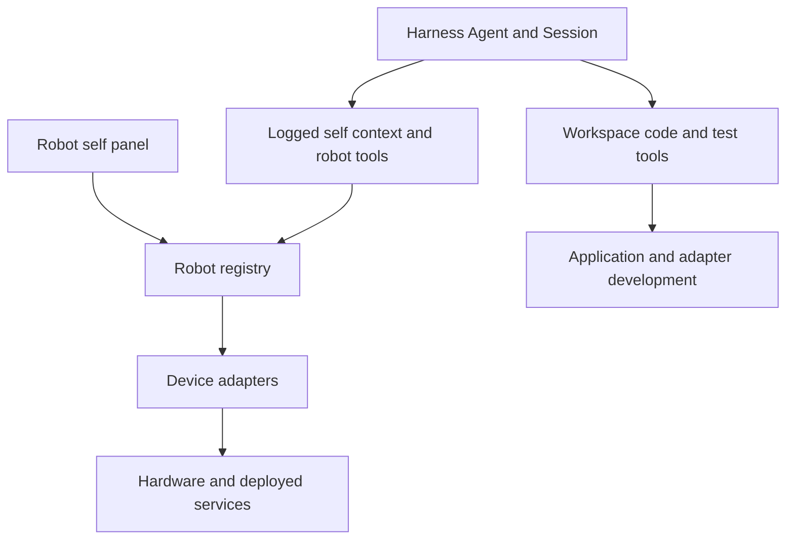

# Embodied Harness

English | [中文](embodied.zh.md)

## Summary

Embodied development runs in the existing Harness Agent and Session. The robot registry provides observed capabilities to conversation tools and the optional self panel. Device adapters own discovery and exact operations; the Agent uses these facts when performing tasks or developing missing capabilities. HomeBody-style spatial memory is an application capability, not the architecture's organizing unit.

## Table of Contents

- [Architecture and directories](#architecture-and-directories)
- [Task and development flow](#task-and-development-flow)
- [Robot portability](#robot-portability)
- [Evidence and execution limits](#evidence-and-execution-limits)
- [Cordis API](#cordis-surface)

<a id="architecture-and-directories"></a>
## Architecture and directories

Conversation and the self panel consume one capability registry. The default embodied composition connects to a real configured gateway; sample project services are optional.



| Directory under packages/experimental | Responsibility |
|---|---|
| [robot](../../packages/experimental/robot/README.md) | Capability declarations, discovery, validated routing and lifetime ownership |
| [robot-g1d](../../packages/experimental/robot-g1d/README.md) | Existing G1-D gateway discovery and verified observations |
| [robot-spatial-memory](../../packages/experimental/robot-spatial-memory/README.md) | Durable semantic observations with historical-coordinate safeguards |
| [tool-robot](../../packages/experimental/tool-robot/README.md) | Logged self context, inspection, observation and action consumers |
| [client-ui-embodied](../../packages/experimental/client-ui-embodied/README.md) | Optional self panel sharing the registry |
| [embodied-bundle](../../packages/experimental/embodied-bundle/README.md) | Profile composition and startup configuration |
| [robot-simulated](../../packages/experimental/robot-simulated/README.md) | Deterministic provider for adapter-independent verification |
| [embodied-project](../../packages/experimental/embodied-project/README.md) | Optional project revisions and sample evidence storage |
| [embodied-development](../../packages/experimental/embodied-development/README.md) | Optional beginner skill and annotated application templates |
| [tool-embodied-project](../../packages/experimental/tool-embodied-project/README.md) | Optional model consumer of sample project commands |

<a id="task-and-development-flow"></a>
## Task and development flow

1. Profile startup loads configured adapters and probes their services. Provider failures remain visible.
2. Prompt assembly and Agent steps refresh capabilities into logged runtime context. The same registry serves explicit inspection and the self panel.
3. The Agent translates the user's goal into required observations and operations, comparing these against actual readiness and declared arguments.
4. Available operations run through exact adapter dispatch; observations and results remain in the Session. Missing operations remain unavailable even if related services report online.
5. Development uses the existing workspace editing and test tools to implement an application or missing adapter. Device-specific units, frames, calibration, freshness and cancellation belong in that adapter.
6. Deployment and physical execution require their own validated integration. Controllers retain motion limits, interlocks and emergency stops; subsequent observations verify outcomes.

<a id="robot-portability"></a>
## Robot portability

Support follows verified interfaces and capability semantics. The G1-D provider covers an installed gateway's observation APIs. G1, H2, Galaxy G1 and differently configured G1-D robots need matching providers; changing a model label cannot confer compatibility. The Agent loop and generic tools remain independent of the vendor.

<a id="evidence-and-execution-limits"></a>
## Evidence and execution limits

A capability separates indirect catalog evidence, directly observed readiness and callable operations. State-reading support does not imply inference, navigation or manipulation support. A failed refresh cannot be presented as a successful live connection, and historical coordinates cannot authorize movement.

Optional project samples retain their own revisions and evidence. Annotation matches are not inference, and an observer's position is not an object's coordinate. Their success does not certify hardware deployment. See the [robot subsystem](robot.md) for execution semantics and controller responsibilities.

<!-- BEGIN GENERATED cordis-surface (gen-cordis-catalog.ts) — do not edit between markers -->

<a id="cordis-surface"></a>

## Cordis API

Generated from source by `scripts/gen-cordis-catalog.ts` (verified fresh by `pnpm run verify-cordis-catalog` in doc-sync; regenerate with `pnpm run gen-cordis-catalog`) — the language sides differ only in locale-specific paired document paths. Signature blocks use a `ts cordis-catalog` fence and keep the original source JSDoc; dispatch modes are defined in the [primer](../cordis-primer.md#dispatch-modes), and the framework-inherited `ctx` API lives in [cordis-api/inherited.md](../cordis-api/inherited.md).

<a id="ctxembodiedprojects--embodiedprojects"></a>

### `ctx.embodiedProjects` — `EmbodiedProjects`

Project persistence and template registration without UI or model dependencies.

```ts cordis-catalog
/**
 * Contribute an application template.
 * @param template - template implementation owned by the caller fiber.
 * @returns disposer; the contributor must own it through ctx.effect.
 */
registerTemplate(template: ProjectTemplate): () => Promise<void>

/**
 * Contribute a target configuration.
 * @param target - target capabilities and execution mode.
 * @returns disposer; the contributor must own it through ctx.effect.
 */
registerTarget(target: ProjectTarget): () => Promise<void>

/**
 * Execute a validated JSON project command and wait for any commit.
 * @param command - catalog, list, create, read, revise, run or export JSON.
 * @param caller - caller cancellation; accepted atomic writes may finish after cancellation.
 * @returns JSON snapshot after successful persistence; rejects conflicts and malformed input.
 */
async execute(command: string, caller: AbortSignal): Promise<string>
```

Source: [`packages/experimental/embodied-project/src/index.ts`](../../packages/experimental/embodied-project/src/index.ts)

<a id="ctxrobotstudio--embodiedworkbench"></a>

### `ctx.robotStudio` — `EmbodiedWorkbench`

Workbench API with plugin-scoped cancellation.

```ts cordis-catalog
/**
 * Discover the currently configured robot and its exact callable operations.
 * @returns A JSON capability inventory; failed providers remain visible.
 */
@Remote async inspect(): Promise<string>

/**
 * Forward a project command without a second data store.
 * @param command - validated by the project service.
 * @returns committed project result or structured Remote failure.
 */
@Remote async dispatch(command: string): Promise<string>
```

Source: [`packages/experimental/client-ui-embodied/src/index.ts`](../../packages/experimental/client-ui-embodied/src/index.ts)
<!-- END GENERATED cordis-surface -->
