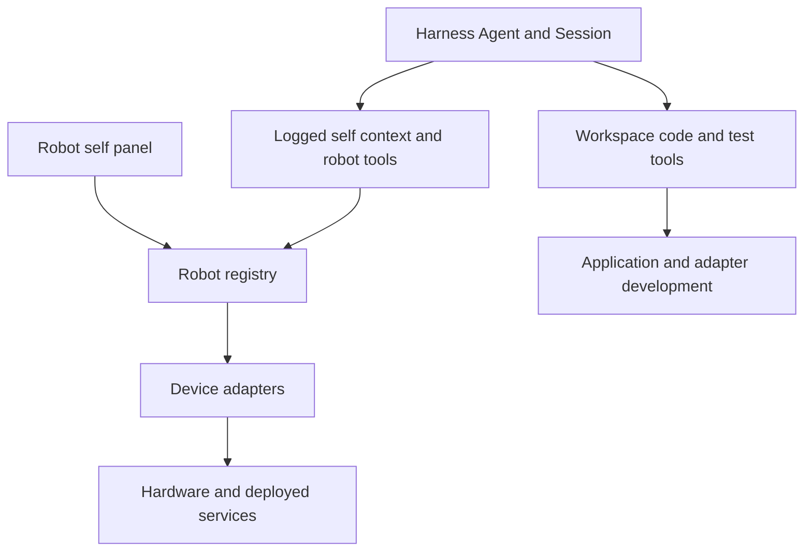

# 具身 Harness

[English](embodied.md) | 中文

## 概述

具身开发运行在现有 Harness Agent 和 Session 内。机器人注册表向对话工具和可选自身面板提供观测到的能力。设备适配器负责发现和准确操作；Agent 执行任务或开发缺失能力时使用这些事实。HomeBody 式空间记忆是一项应用能力，不是整个架构的组织中心。

## 目录

- [架构与目录](#architecture-and-directories)
- [任务与开发流程](#task-and-development-flow)
- [机器人可移植性](#robot-portability)
- [证据与执行限制](#evidence-and-execution-limits)
- [Cordis API](#cordis-surface)

<a id="architecture-and-directories"></a>
## 架构与目录

对话和自身面板消费同一个能力注册表。默认具身组合连接实际配置的网关；样例项目服务是可选项。



| packages/experimental 下的目录 | 职责 |
|---|---|
| [robot](../../packages/experimental/robot/README.zh.md) | 能力声明、发现、经校验路由和生命周期管理 |
| [robot-g1d](../../packages/experimental/robot-g1d/README.zh.md) | 现有 G1-D 网关发现及经过验证的观测 |
| [robot-spatial-memory](../../packages/experimental/robot-spatial-memory/README.zh.md) | 带历史坐标保护的持久语义观测 |
| [tool-robot](../../packages/experimental/tool-robot/README.zh.md) | 已记录的自身上下文、检查、观测及动作消费者 |
| [client-ui-embodied](../../packages/experimental/client-ui-embodied/README.zh.md) | 共享注册表的可选自身面板 |
| [embodied-bundle](../../packages/experimental/embodied-bundle/README.zh.md) | 配置档组合和启动配置 |
| [robot-simulated](../../packages/experimental/robot-simulated/README.zh.md) | 用于独立验证适配器协议的确定性提供者 |
| [embodied-project](../../packages/experimental/embodied-project/README.zh.md) | 可选的项目修订及样例证据存储 |
| [embodied-development](../../packages/experimental/embodied-development/README.zh.md) | 可选的新手技能和带标注应用模板 |
| [tool-embodied-project](../../packages/experimental/tool-embodied-project/README.zh.md) | 可选的样例项目命令模型消费者 |

<a id="task-and-development-flow"></a>
## 任务与开发流程

1. 配置档启动时加载已配置适配器并探测其服务。提供者失败保持显式可见。
2. 提示词组装和 Agent 步骤刷新能力，写入运行上下文日志。同一注册表服务于显式检查和自身面板。
3. Agent 将用户目标转为所需观测和操作，并与实际就绪状态、声明参数进行比较。
4. 可用操作通过准确的适配器路由执行；观测及结果保留在 Session 中。即使相关服务报告在线，缺失的操作仍不可用。
5. 开发使用现有工作区编辑和测试工具实现应用或缺失的适配器。设备专用的单位、坐标系、标定、新鲜度和取消属于适配器职责。
6. 部署和物理执行要求独立验证的集成。控制器保留运动限制、联锁和急停；后续观测用于确认结果。

<a id="robot-portability"></a>
## 机器人可移植性

支持取决于经过验证的接口和能力语义。G1-D 提供者覆盖已安装网关的观测 API。G1、H2、银河 G1 及配置不同的 G1-D 需要匹配的提供者；更改型号标签不能获得兼容性。Agent 循环和通用工具保持与厂商无关。

<a id="evidence-and-execution-limits"></a>
## 证据与执行限制

能力区分目录间接证据、直接观测的就绪状态及可调用操作。支持状态读取不代表支持推理、导航或操作物体。刷新失败不能显示为实时连接成功，历史坐标也不能授权运动。

可选项目样例保留自己的修订及证据。标注匹配不是推理，观察者位置不是物体坐标。样例成功不能认证硬件部署。执行语义及控制器职责见[机器人子系统](robot.zh.md)。

<!-- BEGIN GENERATED cordis-surface (gen-cordis-catalog.ts) — do not edit between markers -->

<a id="cordis-surface"></a>

## Cordis API

Generated from source by `scripts/gen-cordis-catalog.ts` (verified fresh by `pnpm run verify-cordis-catalog` in doc-sync; regenerate with `pnpm run gen-cordis-catalog`) — the language sides differ only in locale-specific paired document paths. Signature blocks use a `ts cordis-catalog` fence and keep the original source JSDoc; dispatch modes are defined in the [primer](../cordis-primer.zh.md#dispatch-modes), and the framework-inherited `ctx` API lives in [cordis-api/inherited.md](../cordis-api/inherited.md).

<a id="ctxembodiedprojects--embodiedprojects"></a>

### `ctx.embodiedProjects` — `EmbodiedProjects`

Project persistence and template registration without UI or model dependencies.

```ts cordis-catalog
/**
 * Contribute an application template.
 * @param template - template implementation owned by the caller fiber.
 * @returns disposer; the contributor must own it through ctx.effect.
 */
registerTemplate(template: ProjectTemplate): () => Promise<void>

/**
 * Contribute a target configuration.
 * @param target - target capabilities and execution mode.
 * @returns disposer; the contributor must own it through ctx.effect.
 */
registerTarget(target: ProjectTarget): () => Promise<void>

/**
 * Execute a validated JSON project command and wait for any commit.
 * @param command - catalog, list, create, read, revise, run or export JSON.
 * @param caller - caller cancellation; accepted atomic writes may finish after cancellation.
 * @returns JSON snapshot after successful persistence; rejects conflicts and malformed input.
 */
async execute(command: string, caller: AbortSignal): Promise<string>
```

Source: [`packages/experimental/embodied-project/src/index.ts`](../../packages/experimental/embodied-project/src/index.ts)

<a id="ctxrobotstudio--embodiedworkbench"></a>

### `ctx.robotStudio` — `EmbodiedWorkbench`

Workbench API with plugin-scoped cancellation.

```ts cordis-catalog
/**
 * Discover the currently configured robot and its exact callable operations.
 * @returns A JSON capability inventory; failed providers remain visible.
 */
@Remote async inspect(): Promise<string>

/**
 * Forward a project command without a second data store.
 * @param command - validated by the project service.
 * @returns committed project result or structured Remote failure.
 */
@Remote async dispatch(command: string): Promise<string>
```

Source: [`packages/experimental/client-ui-embodied/src/index.ts`](../../packages/experimental/client-ui-embodied/src/index.ts)
<!-- END GENERATED cordis-surface -->
